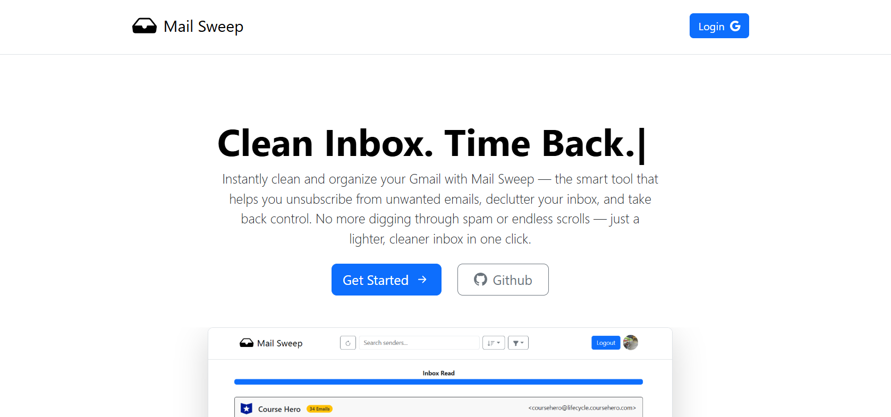

# MailSweep - Gmail Inbox Cleanup Made Easy

**MailSweep** is a full-stack productivity app that gives users control over a cluttered inbox by detecting subscriptions and enabling instant clean-up.



### **The Problem:**
- Gmail inboxes are often flooded with unwanted marketing emails and subscriptions
- Unsubscribing manually is slow and inconsistent across different senders
- Gmail doesn't provide a good interface to bulk unsubscribe by sender

### **Our Solution:**
- **Sender Clustering:** Groups emails by sender to simplify decisions
- **Smart Scan Engine:** Detects and tracks subscriptions automatically
- **Bulk Delete API:** Instantly removes all emails from selected senders
- **Safe Unsubscribe:** Marks sender as unsubscribed without triggering links
- **Session Persistence:** Resumes scans where you left off


## **Key Features**

### **Simple Email Parsing**
```python
"From: Amazon Deals" → 340 emails found → Bulk Delete or Unsubscribe
"From: Newsletter Weekly" → Unsubscribe link detected
```

### **Progressive Gmail Scanning**
```javascript
Batch 1: 100 threads
Batch 2: 100 threads
...
```
- Fetches Gmail threads in batches to avoid rate limits
### **Resume Scan from Last Session**


```json
{
  "lastScanTimestamp": "1750614941"
}
```
- Stored as Unix timestamp for simplicity, easy comparison, and timezone consistency (always UTC)

## **Tech Stack**

### **Frontend**
- **React.js** - Component-based UI with state hooks
- **Bootstrap** - Responsive layout with prebuilt components
- **Axios** – Handles Gmail API calls and backend communication

### **Backend**
- **Express.js** - Lightweight, fast server framework
- **Passport.js** - Secure Google OAuth2 authentication
- **Gmail API** – Email reading, deletion, and metadata fetching
- **Supabase** – PostgreSQL storage with RESTful access


## **Project Structure**

### **Frontend (`frontend/`)**
```
public/                 # Static assets like images
src/
├── components/         # React components (buttons, cards, modals, etc.)
├── css/                # Stylesheets and custom CSS files
├── App.jsx             # Main React app component with routing
├── Home.jsx            # Homepage UI and inbox summary
├── Login.jsx           # Login page with Google OAuth
├── main.jsx            # React entry point and render logic
├── PrivacyPolicy.jsx   # Privacy policy page component
├── TermsOfService.jsx  # Terms of service page component

```

### **Backend (`backend/`)**
```
config/                 # Configuration files (e.g., DB, OAuth)
routes/
├── auth.js             # Authentication routes and logic
├── gmail.js            # Gmail API integration and inbox scanning
├── mailcounter.js      # Counting emails per sender and tracking stats
├── picture.js          # Handling sender favicon or image fetching
├── subscriptions.js    # Managing subscription detection and unsubscribes
utils/
├── index.js            # Utility functions used throughout backend

```


## **How It Works**

### **1. Login via Google OAuth2**
```
Click “Login with Google”
    ↓
Authorize read/delete access to Gmail
    ↓
Redirect to main page with Cookie
```

### **2. Inbox Scan Begins**
```
Fetches email threads using Gmail API
    ↓
Extracts sender metadata and unsubscribe links
    ↓
Updates visual dashboard in real time
```

### **3. User Takes Action**
```python
Click “Unsubscribe” → updates DB to ignore future emails
    ↓
Click “Delete All” → uses Gmail batchDelete API
    ↓
Optionally rescan inbox anytime to fetch new emails since last full scan.
```


## **API Endpoints**

### **Core Endpoints**
```javascript
GET /auth/google // Redirect to Google login

GET /gmail // Triggers Gmail inbox scan

PATCH /unsub // Mark sender as unsubscribed in DB

DELETE /delete // Bulk delete threads by sender
```

### **Example API Usage**
```javascript
router.patch('/unsub', async (req, res) => { 
  const email_id = req.body.email_id;
  await db.query(`UPDATE subscriptions SET is_unsubscribed = $1 WHERE id = $2`, 
    [true, email_id]
  );
  res.status(200).json("Successfully updated is_unsubscribed")
});

```


## **Future Enhancements**
### **Technical Improvements:**
- **Pagination & Lazy Loading** – Improve performance by loading emails in chunks with page navigation instead of rendering all at once (low priority for now) 
### **Summary & Analytics Dashboard** 
- Show users total megabytes of inbox space saved
- Number of emails deleted
- Number of subscriptions cancelled
### **Enhanced Email Card Details:** 
- Show when the sender first started emailing (e.g., “First seen in 2024”)
- Display the date of the most recent email from that sender
- Add category tags (e.g., Social Media, Food, Education, etc.)
- Show how many times the user has starred this sender’s emails

## **About**

### **By:** Galileo Kim and Austin Bao  
### **Status:** Actively maintained & hosted at https://mailsweep.xyz